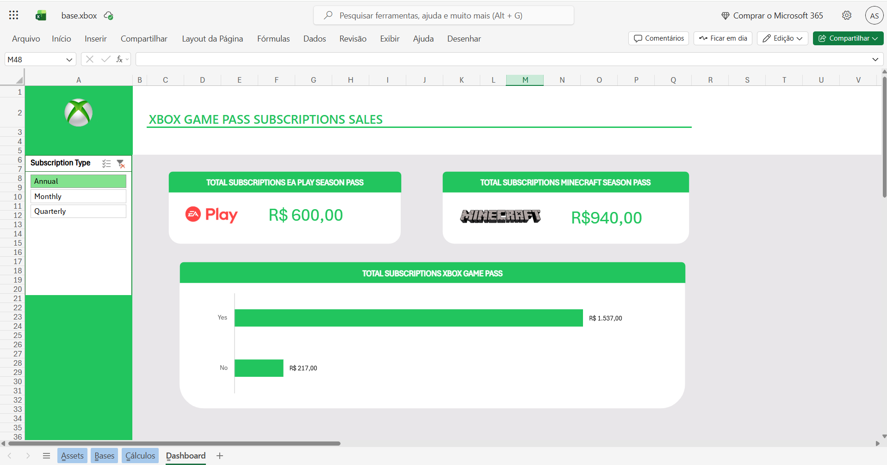
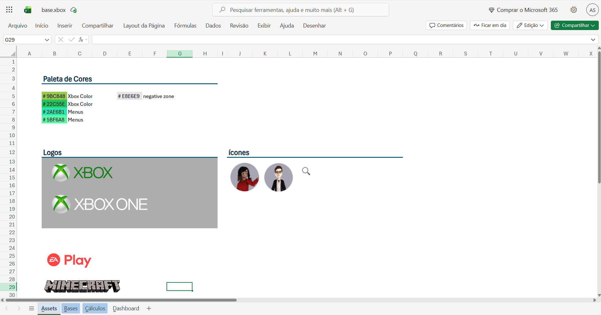
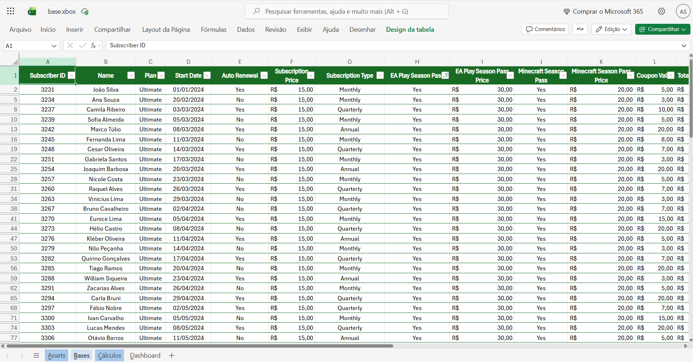
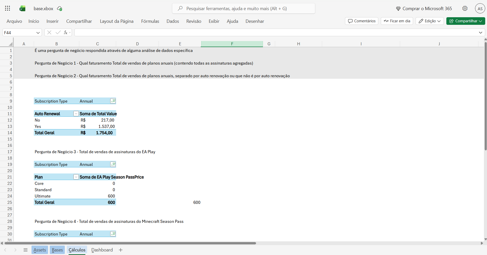

    

-------
 

<h1 align="center">Dashboard de vendas do Xbox</h1>
 
Projeto realizado no Excel com foco na organização e visualização de dados. O objetivo é transformar dados brutos em informações visuais claras e úteis, permitindo uma análise eficaz do desempenho de vendas e a tomada de decisões baseadas em dados.
 
 

## 💻 Explicação:

- Neste dashboard é possóivel acompanhar resultados anuais, mensais e trimestral sobre as vendas do xbox EAplay e minecraft.
  

## ⚠️ Avisos Importantes:
- Dados fictícios
- Feito com Excel